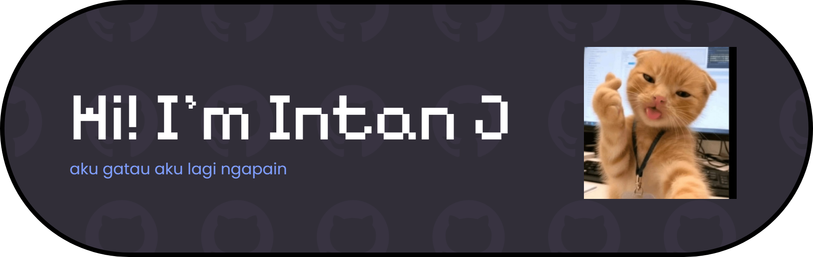

## 안녕하세요 • こんにちは • Ciao

#### 

lowkey don’t know how i ended up in computer science   Trying to learn code little by little   while pretending i totally know what i'm doing. LOL😆

### 😎 biggest achievement
- successfully printed "hello world"
- my code ran without errors once.

### 🔨 skills
- changing vscode themes
- searching errors on google
- pretending to understand git
- surviving somehow

### 💻 Tech Stack:
    

### 🌐 Socials:
 

<!-- Proudly created with GPRM ( https://gprm.itsvg.in ) -->